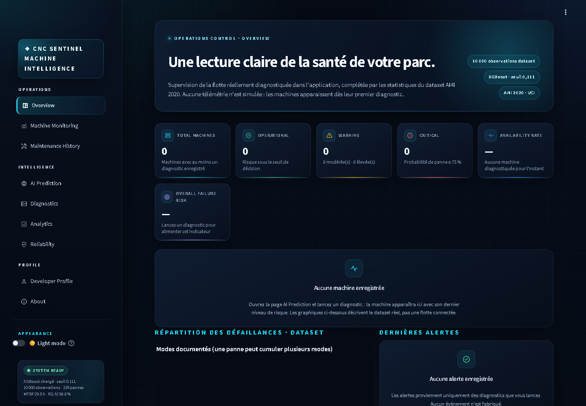
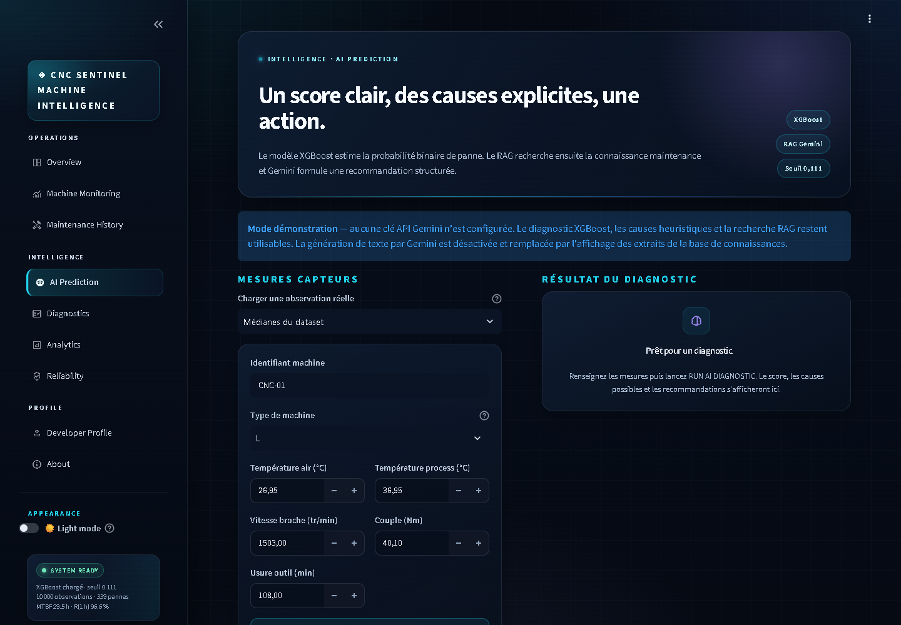
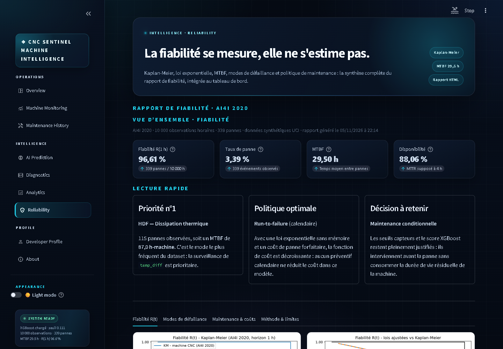
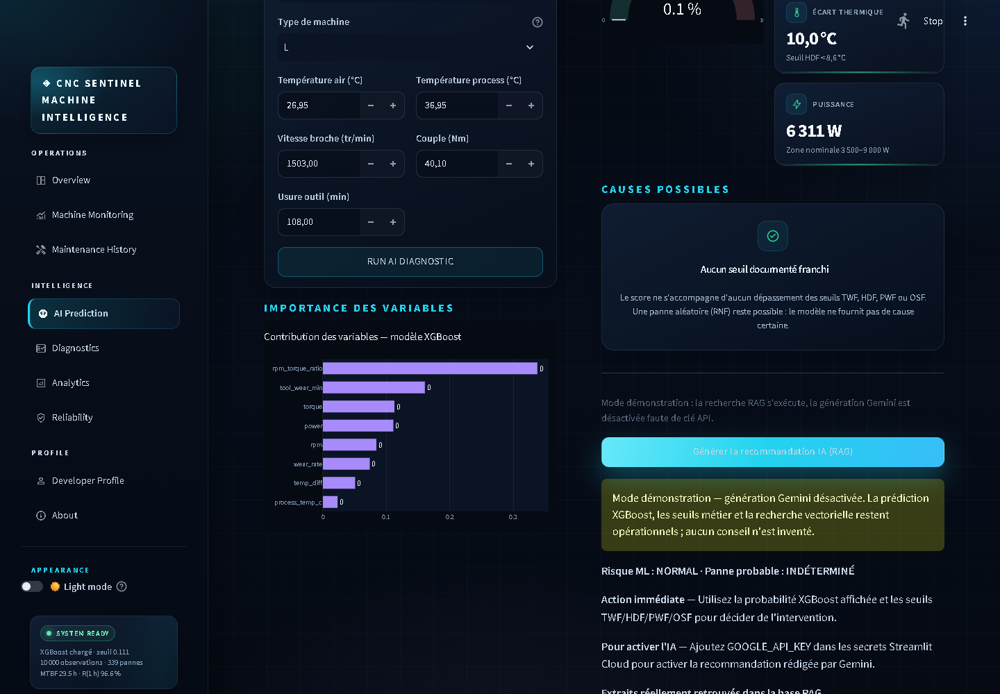
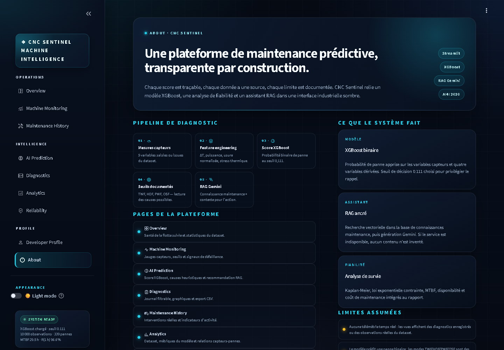
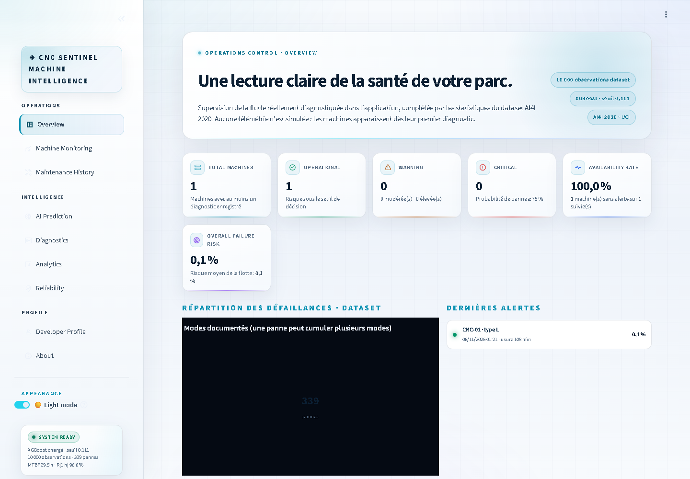

# ⚙️ CNC Sentinel — Maintenance Prédictive

> Plateforme de **maintenance prédictive** pour machines CNC : classification de risque par **XGBoost**, analyse de **fiabilité** (Kaplan-Meier, MTBF) et assistant de recommandation **RAG** (recherche vectorielle + Google Gemini), réunis dans une application **Streamlit**.

[](https://www.python.org)
[](https://streamlit.io)
[](https://xgboost.readthedocs.io)
[](https://aistudio.google.com)
[](https://archive.ics.uci.edu/dataset/601/ai4i+2020+predictive+maintenance+dataset)
[](LICENSE)

- **Version en ligne (démo)** : à ajouter après déploiement sur Streamlit Community Cloud ([voir `docs/DEPLOY_STREAMLIT_CLOUD.md`](docs/DEPLOY_STREAMLIT_CLOUD.md)).
- **Documentation technique (évaluation universitaire)** : [`docs/DOCUMENTATION_TECHNIQUE.md`](docs/DOCUMENTATION_TECHNIQUE.md).
- **Guide de démonstration pas à pas** : [`docs/GUIDE_DEMONSTRATION.md`](docs/GUIDE_DEMONSTRATION.md).

---

## 1. Présentation

**CNC Sentinel** transforme cinq mesures capteurs (températures, vitesse de broche, couple, usure outil) et le type de machine en :

1. une **probabilité binaire de panne** estimée par un modèle XGBoost entraîné sur le dataset **AI4I 2020** (10 000 observations UCI) ;
2. une lecture des **causes possibles** selon les seuils physiques documentés du dataset (TWF, HDF, PWF, OSF) ;
3. une **recommandation d'action** ancrée dans une base de connaissances de maintenance, recherchée par similarité vectorielle (RAG) puis rédigée par Google Gemini.

L'application expose aussi une analyse de **fiabilité** (Kaplan-Meier, lois exponentielle/Weibull contrainte, MTBF, disponibilité, coût optimal) et un journal local des diagnostics et interventions.

> **Aucune donnée n'est inventée.** Les vues affichent des observations réelles du dataset, les sorties du modèle sauvegardé, ou des diagnostics effectivement lancés par l'utilisateur. En l'absence de clé API Gemini, le système bascule en **mode démonstration** : la recherche RAG reste active, la génération de texte est désactivée et l'interface l'indique explicitement.

## 2. Problématique industrielle

Une panne CNC non anticipée coûte cher : arrêt de production, dépannage d'urgence, rebuts, pénalités client. La maintenance préventive au calendrier remplace des pièces encore saines ; la maintenance corrective intervient trop tard.

**Question traitée** : peut-on estimer, à partir de mesures opérateur simples, la probabilité qu'une machine CNC tombe en panne sur l'heure suivante, et en déduire une action de maintenance proportionnée au risque — sans surveiller l'ensemble du parc en temps réel ?

**Réponse du projet** : oui, avec un classificateur binaire supervisé (XGBoost) entraîné sur les motifs de défaillance AI4I 2020, un seuil de décision choisi pour privilégier le **rappel** (peu de pannes manquées), des heuristiques physiques pour l'explicabilité, et un RAG pour transformer un score en plan d'action.

## 3. Objectifs

| # | Objectif | Réalisation |
|---|---|---|
| 1 | Prédire la panne avant qu'elle survienne | XGBoost, AUC-ROC **0,9853** (jeu de test réel) |
| 2 | Rendre la prédiction interprétable | Seuils métier TWF/HDF/PWF/OSF + importance des variables |
| 3 | Transformer le score en action | Recommandation RAG ancrée dans la connaissance maintenance |
| 4 | Mesurer la fiabilité du parc | Kaplan-Meier, MTBF 29,50 h, disponibilité 88,06 % |
| 5 | Tracer chaque décision | Journal de diagnostics et d'interventions, export CSV |
| 6 | Fonctionner sans clé API | **Mode démonstration** explicite (retrieve-only) |

## 4. Fonctionnalités

| Page | Contenu |
|---|---|
| **Overview** | Santé du parc diagnostiqué, KPI de risque, répartition des modes de panne, dernières alertes. |
| **Machine Monitoring** | Jauges des 5 capteurs, plages d'entraînement, signaux de dépassement de seuils. |
| **AI Prediction** | Formulaire de diagnostic, jauge de probabilité, causes possibles, importance des variables, recommandation RAG. |
| **Diagnostics** | Journal filtrable des diagnostics lancés, graphiques, export CSV. |
| **Maintenance History** | Saisie et consultation des interventions, indicateurs d'activité. |
| **Analytics** | Explorations du dataset, métriques du modèle (ROC, PR, seuils, matrice de confusion). |
| **Reliability** | Rapport de fiabilité : Kaplan-Meier, MTBF par mode, disponibilité, politique de maintenance optimale. |
| **Developer Profile** | Présentation des deux auteurs. |
| **About** | Architecture, provenance des données, limites assumées, technologies. |

Thème sombre par défaut, **basculable en thème clair** (sidebar → *Light mode*).

### Captures d'écran

|  |  |
|---|---|
|  |  |
|  |  |
|  |  |

Toutes les captures sont dans [`docs/screenshots/`](docs/screenshots/).

## 5. Architecture technique

```
┌─────────────────────────────────────────────────────────────────┐
│  Interface Streamlit (app/) — 9 pages, thème sombre/clair      │
│  Overview · Monitoring · Prediction · Diagnostics ·            │
│  Maintenance · Analytics · Reliability · Developer · About     │
└──────────────┬──────────────────────┬───────────────────────────┘
               │                      │
┌──────────────▼──────────┐  ┌────────▼─────────────────────────┐
│ data_access.py          │  │ rag/agent.py — MaintenanceAgent │
│ - charge modèle + scaler│  │ 1. requête RAG (ChromaDB)       │
│ - features physiques    │  │ 2. chunks cnc_knowledge.md      │
│ - seuils métier TWF/…   │  │ 3. LLM Gemini (si clé dispo)    │
│ - métriques sur test    │  │ sinon MODE DÉMO (retrieve-only) │
└──────────────┬──────────┘  └────────▲─────────────────────────┘
               │                      │
┌──────────────▼──────────────────────┴─────────────────────────┐
│ models/   train.py · evaluate.py · feature_engineering.py     │
│           data_loader.py    → xgboost_model.pkl + scaler.pkl   │
│ data/raw/ai4i2020.csv (UCI AI4I 2020, CC BY 4.0)              │
│ data/processed/  CSVs · figures · reliability_summary.json     │
│ data/knowledge/cnc_knowledge.md → ChromaDB (embeddings)       │
└─────────────────────────────────────────────────────────────────┘
```

Pipeline de diagnostic : **mesures capteurs → feature engineering physique → scaler → XGBoost → probabilité → seuil 0,111 → causes heuristiques → recherche RAG → recommandation**.

## 6. Technologies utilisées

| Domaine | Technologies |
|---|---|
| Langage | Python ≥ 3.11 (développé en 3.12) |
| Interface | Streamlit, Plotly, HTML/CSS sur mesure |
| Machine Learning | XGBoost, scikit-learn, pandas, NumPy, joblib |
| Fiabilité | lifelines (Kaplan-Meier), SciPy |
| RAG | LangChain, ChromaDB, sentence-transformers, Google Gemini |
| Visualisation statique | Matplotlib, Seaborn |

## 7. Méthodologie Machine Learning

### Données

Dataset **AI4I 2020 Predictive Maintenance** (UCI, S. Matzka, DOI [10.24432/C5HS5C](https://doi.org/10.24432/C5HS5C), CC BY 4.0) : **10 000 observations synthétiques** de fraiseuses CNC, **339 pannes (3,39 %)**, 5 modes : TWF (46), HDF (115), PWF (95), OSF (98), RNF (19). Voir [`docs/DONNEES_ET_LICENCES.md`](docs/DONNEES_ET_LICENCES.md).

### Features physiques

5 variables capteurs (`air_temp_c`, `process_temp_c`, `rpm`, `torque`, `tool_wear_min`) + 5 dérivées :

| Feature | Définition | Lecture |
|---|---|---|
| `temp_diff` | `process_temp_c − air_temp_c` | écart thermique (seuil HDF < 8,6 °C) |
| `power` | `rpm × torque` | proxy de puissance mécanique |
| `wear_rate` | `tool_wear_min / (rpm + 1)` | usure rapportée à la rotation |
| `rpm_torque_ratio` | `rpm / (torque + 1)` | **feature la plus importante** |
| `wear_temp_stress` | `tool_wear_min × temp_diff` | interaction usure × thermique |

Les 10 numériques sont normalisées (`StandardScaler`) ; `type_M` encode le type de machine.

### Entraînement

- `XGBClassifier(n_estimators=100, max_depth=6, learning_rate=0.1, scale_pos_weight = n_normal/n_failure, random_state=42)`.
- Split train/test **80/20 stratifié** (`random_state=42`) : test = **2 000 lignes, 68 pannes**.

### Résultats réels (jeu de test)

| Métrique | Valeur |
|---|---|
| AUC-ROC | **0,9853** |
| AUC-PR | **0,8752** |
| **Seuil application 0,111** | précision 0,4511 · rappel **0,8824** · F1 0,5970 · TN 1859 / FP 73 / FN 8 / TP 60 |
| Seuil 0,5 | précision 0,7342 · rappel 0,8529 · F1 0,7891 |
| Meilleur F1 | 0,8438 au seuil 0,8653 |

Le seuil **0,111** (et non 0,5) est un choix métier : manquer une panne coûte plus cher qu'une fausse alerte ; le rappel 0,88 correspond à **8 pannes manquées sur 68**. Les courbes ROC/PR et l'analyse des seuils sont visibles dans la page **Analytics**.

**Importances (gain)** : `rpm_torque_ratio` 0,338 · `tool_wear_min` 0,161 · `torque` 0,113 · `power` 0,111 · `rpm` 0,084.

### Analyse de fiabilité

| Indicateur | Valeur |
|---|---|
| Fiabilité R(1 h) Kaplan-Meier | 96,61 % |
| MTBF | 29,50 h |
| Disponibilité (MTTR supposé 4 h) | 88,06 % |
| Mode prioritaire | HDF — 115 pannes, MTBF 87,0 h |
| Politique optimale (coût Cp 500 € / Cf 20 000 €) | *run-to-failure* + surveillance conditionnelle |

Détail reproductible : `python reliability_analysis.py` (produit `reliability_summary.json`, figures et rapport HTML).

## 8. Installation

Prérequis : Python ≥ 3.11, Git (optionnel).

### Windows (PowerShell)

```powershell
git clone <URL-DU-DEPOT> cnc-predictive-maintenance
cd cnc-predictive-maintenance
python -m venv .venv
.venv\Scripts\Activate.ps1
python -m pip install -r requirements.txt
python -m streamlit run app/streamlit_app.py
```

### Linux / macOS

```bash
git clone <URL-DU-DEPOT> cnc-predictive-maintenance
cd cnc-predictive-maintenance
python3 -m venv .venv
source .venv/bin/activate
python -m pip install -r requirements.txt
./run_app.sh
```

L'application démarre sur `http://localhost:8501`. Le modèle, le scaler, les données traitées et la base vectorielle ChromaDB sont **déjà inclus** : aucune réentraînement n'est nécessaire.

### Clé API (optionnel — recommandation RAG complète)

Sans clé, l'application fonctionne en **mode démonstration** (probabilité XGBoost + seuils + recherche RAG ; génération Gemini désactivée).

Pour activer la génération de texte, en local :

```bash
cp .env.example .env
# puis renseigner GOOGLE_API_KEY dans .env (ne jamais le committer)
```

Sur **Streamlit Community Cloud**, renseigner le secret dans *App settings → Secrets* — jamais dans le code ni sur GitHub.

## 9. Utilisation

1. Ouvrir **AI Prediction**, choisir un preset d'observation réelle (*Médianes*, *TWF*, *HDF*…) ou saisir les 5 mesures.
2. Cliquer **RUN AI DIAGNOSTIC** : le score XGBoost, la jauge de risque et les causes possibles s'affichent ; le diagnostic est journalisé (page **Diagnostics**).
3. Cliquer **Générer la recommandation IA (RAG)** : en mode complet, Gemini rédige analyse, action immédiate et prévention ; en mode démo, les extraits de la base de connaissances sont affichés tels quels.
4. Consulter **Analytics** (métriques) et **Reliability** (fiabilité), **About** (limites).

Guide complet : [`docs/GUIDE_DEMONSTRATION.md`](docs/GUIDE_DEMONSTRATION.md).

## 10. Limites du système

- **Données synthétiques** : les conclusions doivent être validées sur des mesures d'atelier réelles.
- **Pas de télémétrie temps réel** : les vues montrent l'historique des diagnostics lancés, pas une flotte connectée.
- **Classification binaire** : XGBoost prédit *panne / normal* ; les modes TWF/HDF/PWF/OSF sont des **heuristiques de seuils**, pas une classification multi-classes.
- **Fuite de données légère** : le `StandardScaler` a été ajusté avant le split train/test (documenté dans le code et dans la page About) — les métriques peuvent être légèrement optimistes.
- **Dépendances externes** : la génération RAG requiert Google Gemini ; le premier chargement télécharge le modèle d'embeddings (~470 Mo).

## 11. Reproductibilité

```bash
python -m models.data_loader          # télécharge le dataset UCI → data/raw/ai4i2020.csv
python prepare_data.py                # K → °C, copie nettoyée → data/processed/ai4i2020_clean.csv
python -m models.feature_engineering  # features + scaler → ai4i2020_features.csv, scaler.pkl
python -m models.train                # entraînement → models/xgboost_model.pkl
python -m models.evaluate             # ROC/PR/seuils → figures
python reliability_analysis.py        # fiabilité → reliability_summary.json, figures, rapport HTML
```

## 12. Auteurs

### Ghaith Mouelhi
**Electrical Engineering and Automation**

- LinkedIn : <https://www.linkedin.com/in/ghaith-mouelhi-a5b668278/>
- Portfolio : <https://ghaieth-mouelhi.netlify.app/>

### Chadi Ammar
**Electrical and Automation Engineering Student**

- LinkedIn : <https://www.linkedin.com/in/chadi-ammar/>

## 13. Citation et licences

Voir [`CITATION.cff`](CITATION.cff), [`LICENSE`](LICENSE) et [`docs/DONNEES_ET_LICENCES.md`](docs/DONNEES_ET_LICENCES.md) (dataset UCI AI4I 2020, CC BY 4.0 ; bibliothèques open source).

---

*Projet universitaire — CNC Predictive Maintenance. Développé par Ghaith Mouelhi et Chadi Ammar.*
